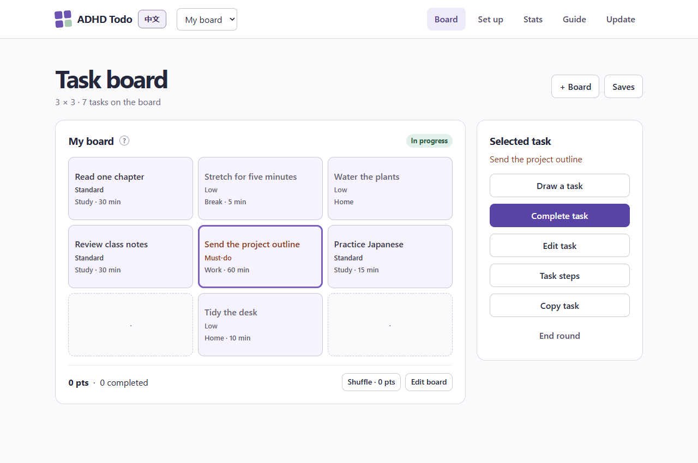

# ADHD Todo

[中文说明](#zh)

**[Play ADHD Todo in your browser](https://yokohamabluesss.github.io/adhd-todo/)** on a phone or computer. Your progress saves in the browser you play in.

ADHD Todo is for people with ADHD. Let chance pick your first small step and a lucky Bingo be your cue to call it a day. Enjoy your round!

On your first visit, **Sample board** opens with all nine squares filled. Choose **Start round → Draw a task** to try it immediately, or open **Stats** to explore 30 simulated days, 38 finished rounds and 75 task completions. Choose **+ Board** for an empty personal board. The language button beside the logo switches between English and Simplified Chinese.



## Play a round

When the whole list feels overwhelming, leave ideas in the Everyday and One-off libraries and put just a few actions from any projects on the board. A draw can choose where to begin or which project to return to. If stopping brings up “Have I done enough?”, try making a deal with yourself before you start: a lucky line is enough reason to stop. You choose when to end, and the unfinished squares carry over.

Put what is on your mind on the board. If that is “Write my paper”, save it once in the Everyday library and place three copies with that same name. Each eligible copy gets a chance in the draw. When one comes up, do as much writing as suits this turn.

1. **Choose what goes on the board.** In **Set up**, add a task to a library and tap an empty square to place it, or drag it there. Everyday tasks can be used repeatedly. One-off tasks move onto the board. Leave as many squares empty as you like. Drag an unfinished task back to its own library to take it off the board.
2. **Draw or pick a task.** While any Must-do squares remain, the draw chooses only among them, with equal chances. Otherwise each Standard square has twice the weight of a Low square by default. Adjust the weights in **Set up → Board settings**. **Guide → How the draw works** shows the odds for your board. You can always choose a square yourself.
3. **Take a small step.** Select a square and open **Task steps** to give it a 2×2 step grid. Finishing a step clears its text. Confirm **Complete task** on the main board when the whole task is done. Right-click a square to edit the task, open its steps or add a note. Notes support text and one JPEG, PNG or WebP image. Select the square to open its note from the card beneath the controls.
4. **Decide when to stop.** A full row, column or main diagonal of squares completed this round makes a Bingo. A line plus all Must-do tasks finished earns success. Finishing everything on a sparse board also succeeds. Each main task earns one point per full 30 planned minutes, with a minimum of one. A shuffle costs one point per square already completed this round and moves the completion marks too. Choose **End round** when you’re ready. Unfinished tasks and their steps carry over.

| To explore | Open |
| --- | --- |
| Play a four-task round from setup to Bingo, including on a phone | [First round in screenshots](docs/first-round.md) |
| Change draw weights, resume a task, transfer a save or preview a reset | [Detailed walkthrough](docs/detailed-walkthrough.md) |
| See why the board offers manual choices, small steps and early endings | [ADHD design notes](docs/adhd-design-notes.md) |

## Run locally

Install Node.js 24 or later. Run these commands from the project folder, keep the terminal open, then open [the local board](http://127.0.0.1:4174/).

```sh
npm ci
npm run dev
```

On Windows PowerShell, use `npm.cmd` if needed. For the production build, stop the dev server, run `npm run build` and then `npm run preview`. Both use the same local address. For a Windows desktop shortcut, run `.\scripts\desktop-shortcut.ps1` in PowerShell. The shortcut starts or reuses the preview. Rebuild after source updates and recreate the shortcut if you move the project. A bookmark works while the server is running.

<a id="home-wifi"></a>

### Use your phone on home Wi-Fi

1. Connect both devices to the same home network. With dependencies installed, run `npm run build` and then `npm run preview:lan` on the computer.
2. Open the **Network** address printed by Vite in the phone browser, including port **4175**. Keep the computer awake and the terminal open. If the address is unreachable, check guest-network isolation and the Windows Firewall permission for Node.js on your private network. Press **Ctrl+C** to stop the preview.
3. The phone keeps its own progress. To move an open round between devices, export and import a save as described below.

## Saves and board settings

In **Set up** on the sample board, hover over, focus or tap the **?** beside an action to see what it does. Try moving **Return a library book** from the One-off library onto an empty square. On the full starting grid, first return an everyday square to its library to make room. On any board, **Board settings** has help beside **Day starts at**, **Side length** and **Group by row**.

Changes save automatically to this browser profile at this web address. Each board has its own tasks, libraries, balance and stats. Select **Default board** in **Set up → Board settings** to choose which board opens next time. There you can also set the board size (2×2 to 12×12 between rounds), enable shuffling within rows and choose when your board day starts (04:00 local time by default).

| Action | Effect |
| --- | --- |
| **Right-click a board square → Delete task** | Confirm to discard this placement, including its notes and steps. Other copies and both libraries stay as they are. The empty square earns no points and does not count toward Bingo. |
| **Saves → Download current board** | Exports this board with its libraries and progress. **Import a save → Add board** adds an independent copy and preserves your default board. |
| **Saves → Download all boards** | Exports one SQLite file with all boards, including notes, images, steps and open rounds. **Import a save → Replace boards** replaces every board in the destination profile. Download a backup there first if needed. |
| **Saves → Reset…** | **Reset today's progress** applies to rounds started on the current board day. **Reset all progress** clears this board’s progress across days. Both restore tasks completed in an affected open round. **Clear all squares** empties the main board and closes an open round while keeping its points and history. Each option previews its effects before confirmation and keeps both libraries. |
| **Set up → Board settings → Delete current board** | The confirmation names the board. Deleting it removes its libraries and history too. Deleting the last board opens an empty **My board**. |

The web app runs SQLite locally with sql.js and stores a snapshot in IndexedDB. Full backups still use v3 and the app can also open v1 and v2 backups. Single-board downloads use v4 so older apps recognize that an update is needed. Missing weights in older saves default to 2:1. Older files retain the history they recorded. An unsupported save version leaves your current boards in place.

## What Stats tells you

Use **Daily calendar** to find what you finished on a given board day, or switch to **Per-round bars** to see how much fits into a round. Round outcomes follow the day the round **started**. The calendar counts a completion on the day you **finished** the task. Changing the day boundary preserves previously assigned round dates.

Completion shares show which tasks made up the work you finished. Placement completion rates show how many tasks from a particular intake you eventually finished, including ones carried across rounds. First-draw adoption and distance at early stops can help you decide whether to try a different first task or a smaller board. Hover over, focus or tap a **?** for reading tips. [Metric definitions, displays, SQL examples and a proposed experiment](docs/metrics.md)

A separate Python study compares the chance of making Bingo after 3–7 completions across six layouts and choice strategies. The playable sample and the probability experiment have different purposes. [Probability tables and reproducible simulation](docs/bingo-probability.md)

## Roadmap and verification

| Stage | Plans |
| --- | --- |
| Current | Playtest the web app, especially starting, resuming and moving rounds between browsers. **Update** lists recent changes and planned features. |
| Next version | Offer a downloadable Python service that reads and writes a local SQLite file and can continue an exported web round. |
| Planned features | Refine draw rules and round goals. Add an optional timer, Pomodoro sessions, finer time increments and comparisons of planned and actual focus time. Use scripts and an optional AI API to interpret personal board statistics. |
| Later candidates | Per-task targets, luck mode, optional deadline-based priority changes, and desktop or mobile clients. |

Run `npm test` for rule, storage-format and statistics checks. With the app running at port 4174 and Edge installed, `npm run test:browser` exercises the interface. Run `node tests/walkthrough.mjs` and `node tests/detailed-walkthrough.mjs` to replay the illustrated examples and regenerate their images. Set `BROWSER_CHANNEL=chrome` to use an installed Chrome.

The author designed the task flow and game rules. AI assisted with implementation, edge-case review, testing and documentation.

---

<a id="zh"></a>

# ADHD Todo 中文说明

**[点这里直接玩 ADHD Todo](https://yokohamabluesss.github.io/adhd-todo/)**。手机和电脑浏览器都可以打开，进度保存在你试玩的浏览器里。

希望有 ADHD 的你既能轻松开始，也能安心收工。让抽签帮你选第一步，遇上 Bingo 就可以说「今天做到这里也很好」。祝你玩得开心！

首次打开会进入 **Sample board**，九个格子都已摆好。点 **Start round → Draw a task**（开始本轮 → 抽一项任务）就能试玩。打开 **Stats**（统计）可以查看 30 个模拟使用日、38 个已结束轮次和 75 次任务完成。想从空盘开始，点 **+ Board** 新建个人棋盘。标志旁的语言按钮可以切换英文和简体中文。


## 玩一轮

待做的事一多，可以先把它们存在日常库和临时库。回到棋盘，只看这轮挑的几个动作。几个项目可以穿插着做，拿不定主意就抽一格。如果收工时总忍不住想「我是不是做得不够」，不妨开局前和自己约好：「碰巧连成一条线，今天就可以到这里。」最后由你点结束，没做完的格子留给下一轮。

把眼前惦记的事放上来就好。比如今天更想写论文，就在日常库只存一份「写论文」，在主棋盘放三个同名格。每个符合抽选条件的格子都有自己的机会。抽到时，这一回合想写多少就写多少。

1. **只摆眼前想面对的事。** 在 **Set up**（摆盘）中往库里添加任务，再点一个空格放上去，也可以拖放。日常任务可反复取用，临时任务会从库里移到主板。棋盘可以留白。想撤下一项，在摆盘页把它拖回原来的任务库。
2. **让棋盘选，也可以自己挑。** 只要还有必做任务，就只在必做格之间等概率抽选。其余时候，每个标准格的默认权重是低优先级格的两倍。在 **摆盘 → 棋盘设置** 调整权重，在 **使用指南** 查看当前盘面的实际概率。你随时可以手选其他任务。
3. **先动一小步。** 选中格子，打开 **Task steps**（任务步骤），从 2×2 的步骤矩阵开始。完成子步骤会清空子格文字。等整件事做完，再到主板确认 **完成任务**。电脑上右键格子可编辑任务、打开步骤或添加备注。备注支持文字和一张 JPEG、PNG 或 WebP 图片。选中格子后，点操作栏下方的备注卡片即可查看详情。
4. **自己决定何时收工。** 本轮亲手完成一整行、一整列或一条大对角线即可 Bingo。有连线且必做任务全部完成，本轮成功；盘面留白时做完摆上的所有任务，也算成功。主任务按预计时长每满 30 分钟给 1 点，最少 1 点。打乱花费等于本轮已完成格数，完成标记也跟着移动。想收工时点 **结束本轮**，未完成的任务和步骤会留到下一轮。

| 想做什么 | 看哪一份 |
| --- | --- |
| 从摆四个任务开始，亲手体验抽选、步骤和 Bingo，或在手机上试玩 | [第一次玩 ADHD Todo · 图文指引](docs/first-round.md#zh) |
| 设置权重、接着上次的步骤做、迁移存档或查看重置效果 | [详细操作图解](docs/detailed-walkthrough.md#zh) |
| 了解手选、小步骤和提前收工分别想解决什么困难 | [为什么给 ADHD 做一块任务棋盘](docs/adhd-design-notes.md#zh) |

## 在电脑上运行

安装 Node.js 24 或更新版本，在项目目录运行以下命令，保持终端开启，然后打开[本机棋盘](http://127.0.0.1:4174/)。

```sh
npm ci
npm run dev
```

Windows PowerShell 下可用 `npm.cmd`。要使用正式构建，先停止开发服务，再依次运行 `npm run build` 和 `npm run preview`。两种方式使用同一本机地址。要在 Windows 桌面建立入口，可在项目目录的 PowerShell 运行 `.\scripts\desktop-shortcut.ps1`。快捷方式会启动或复用预览。更新源码后重新构建，移动项目后重新创建快捷方式。预览运行期间也可从收藏夹打开。

<a id="home-wifi-zh"></a>

### 在家用手机打开

1. 手机和电脑连接同一个家庭网络。电脑安装项目依赖后，依次运行 `npm run build` 和 `npm run preview:lan`。
2. 手机浏览器打开 Vite 在终端打印的 **Network** 地址，保留端口 **4175**。保持电脑唤醒、终端开启。如果连不上，检查访客网络隔离，以及 Windows 防火墙是否允许 Node.js 通过专用网络。按 **Ctrl+C** 可停止预览。
3. 手机独立保存进度。要把电脑上进行的轮次带到手机，可以用下面的存档功能。

## 存档与棋盘设置

在示例的 **摆盘** 页，将鼠标移到按钮旁的 **?**，用 Tab 聚焦它，或轻点它，就能看到点击后的效果。可以先把满盘中的一个日常任务退回库里，腾出一格，再从临时库把 **Return a library book**（还图书馆的书）放上去。所有棋盘的 **棋盘设置** 都在 **一天的开始时间**、**每边格数** 和 **按行分组** 旁提供问号说明。

程序自动在当前网址、当前浏览器配置中保存。每块棋盘有独立的任务、任务库、余额和统计。在 **摆盘 → 棋盘设置** 勾选 **默认棋盘**，即可指定下次打开哪一块。这里也可以在轮次之间调整棋盘尺寸（2×2 至 12×12）、启用行内打乱，以及设置一天从几点开始（默认当地时间 04:00）。

| 操作 | 实际效果 |
| --- | --- |
| **右键主格 → 删除任务** | 确认后删除这一格的任务、备注和步骤，其他副本和两个任务库保留原状。空格不发点，也不参与 Bingo 连线。 |
| **存档 → 下载当前棋盘** | 导出这块棋盘及其任务库和进度。**导入存档 → 添加棋盘** 会追加独立副本，保留原来的默认棋盘。 |
| **存档 → 下载所有棋盘** | 一个 SQLite 文件包含全部棋盘、文字与图片备注、步骤和进行中的轮次。**导入存档 → 替换棋盘** 会替换目标浏览器配置中的全部棋盘，有需要时先在目标端下载备份。 |
| **存档 → 重置…** | **重置今日进度** 按本棋盘的分日时间，处理今天开始的轮次。**重置全部进度** 处理该棋盘所有日期。两者都会还原受影响的进行中轮次里已完成的主任务。**清空棋盘** 清空主板，按当前结果结束进行中的轮次，保留点数和历史。三项操作都有确认页，都会保留两个任务库。 |
| **摆盘 → 棋盘设置 → 删除当前棋盘** | 确认框显示棋盘名称。确认后连同该棋盘的任务库和历史一起删除。删掉最后一块会打开空白的 **My board**。 |

网页版通过 sql.js 在本地运行 SQLite，把快照保存在 IndexedDB。全量备份沿用 v3，也可读取 v1、v2 旧备份。单棋盘文件使用 v4，旧版程序打开时会提示需要更新。旧档缺少权重时按 2:1 处理，原先记录过的历史可继续查看。导入不支持的版本时会保留现有棋盘。

## 统计能帮你看什么

用默认的 **活动日历** 找到某个棋盘日实际完成的任务数量，切换到 **逐轮柱状图** 可以看一轮通常能做多少。轮次结果归到**开始那一轮**的棋盘日，日历按**实际完成任务**的棋盘日计数。修改分日时间后，已开始的轮次保留原归属日期。

完成占比用来看“做完的事情里，哪些占得多”。上板完成率用来看“那段时间摆上的任务，到现在做完了多少”，跨轮留存只算一次上板。首抽采纳情况和提前收工差距，可以帮你考虑是否换一个起步任务，或少摆几项。悬停、键盘聚焦或轻点 **?** 可以查看解读提示。[指标口径、展示方式、SQL 示例与试验设计](docs/metrics.md#zh)

另有一项独立的 Python 研究，比较六种布局与选择策略下，完成 3 至 7 项时的 Bingo 概率。你可以用它了解规则怎样影响连线机会，再到示例棋盘上亲自试玩。[概率表与可复跑的模拟](docs/bingo-probability.md#zh)

## 后续计划与验证

| 阶段 | 计划 |
| --- | --- |
| 当前 | 试玩网页版，优先检查开局、恢复进度和跨浏览器迁移。程序的 **Update**（更新）页面列出近期变化和计划功能。 |
| 下一版 | 提供本机运行的 Python 服务，读写本地 SQLite 文件，可以接着网页版导出的轮次做。 |
| 功能计划 | 优化抽选规则、增加轮次目标，加入可选计时器、番茄钟、更细的时间单位和预计与实际专注时长的对照。用脚本和可选 AI 接口解读个人统计。 |
| 后续候选 | 单项任务目标、幸运模式、临期可选升优先级，以及独立桌面或手机客户端。 |

运行 `npm test` 检查规则、存档格式和统计。安装 Edge 并让应用在 4174 端口运行后，运行 `npm run test:browser` 验证界面流程。运行 `node tests/walkthrough.mjs` 和 `node tests/detailed-walkthrough.mjs` 可重玩两份图解并生成截图。将环境变量 `BROWSER_CHANNEL` 设为 `chrome` 可使用已安装的 Chrome。

任务流程和游戏规则由作者设计。AI 协助实现、边界检查、测试和文档整理。
