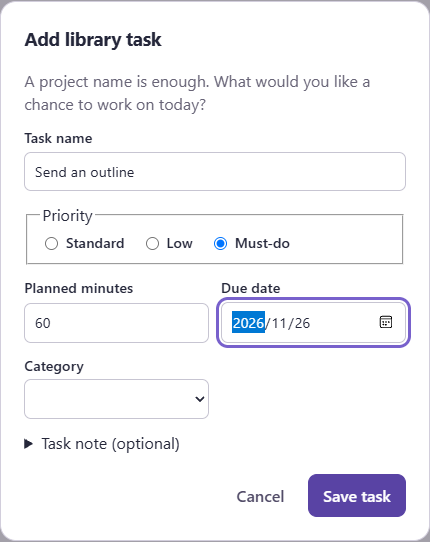
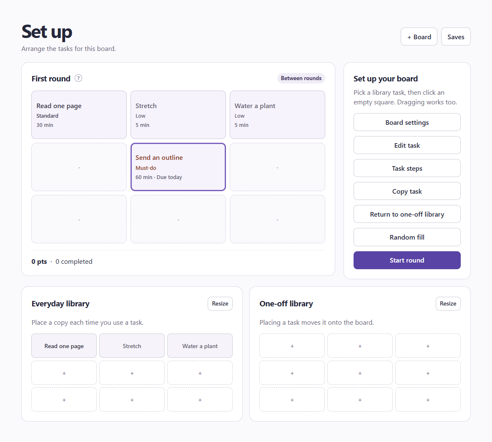
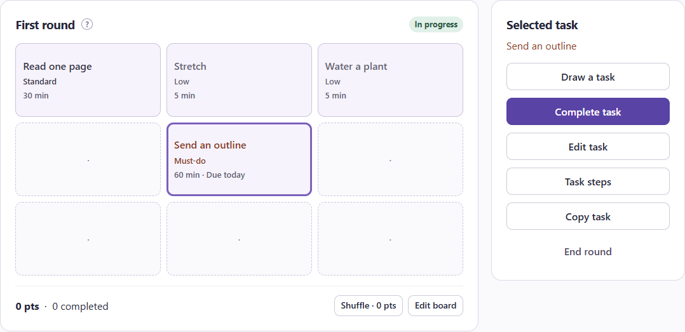
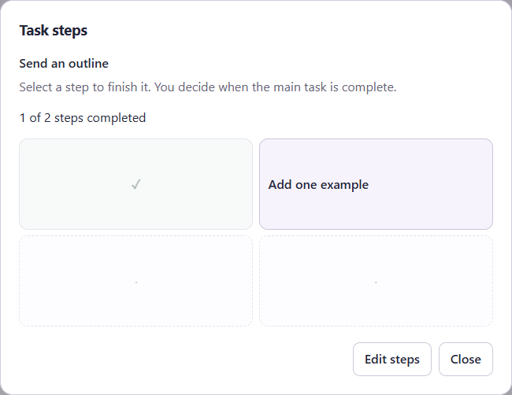
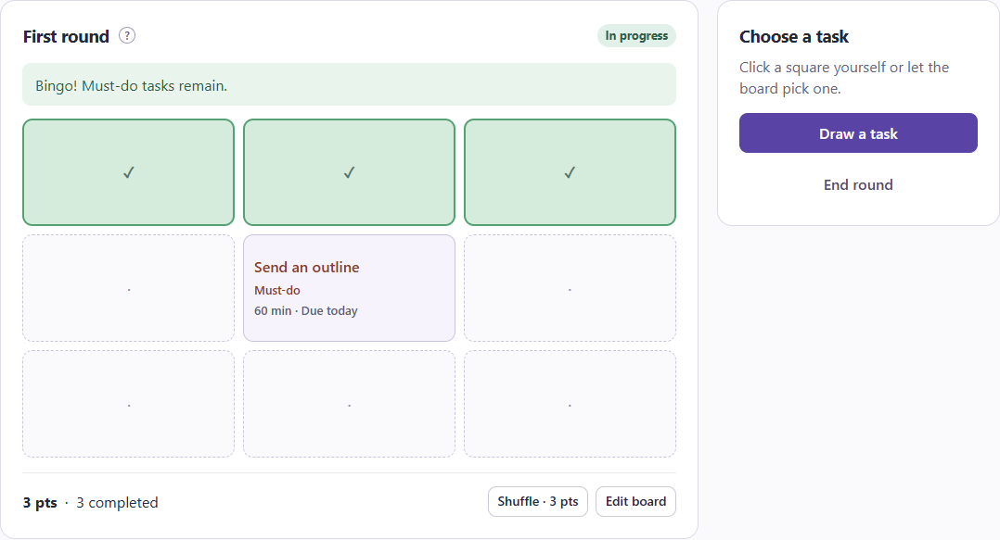
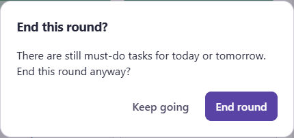
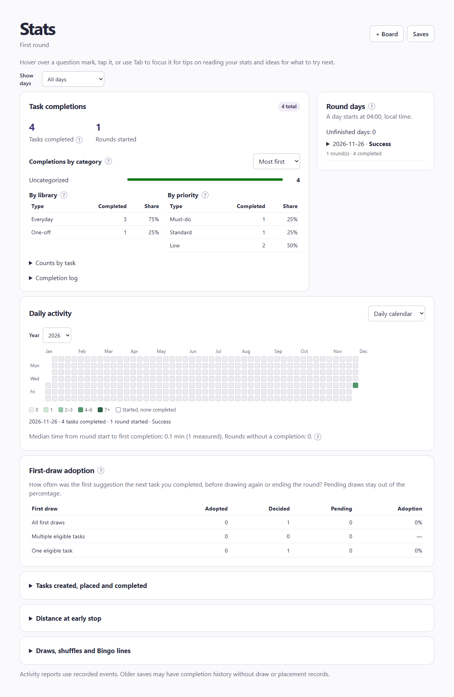
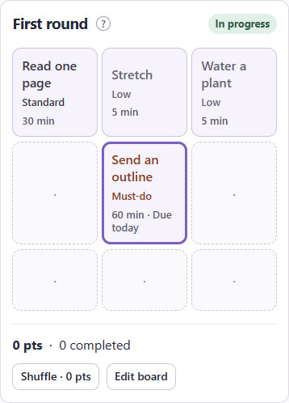

# Your first round of ADHD Todo

[Jump to the Chinese edition](#zh)

If picking the first task is the hard part, let the board pick one for you. For a quick trial on an empty board of your own, choose **+ Board**, place **one task**, start a round and complete it. If you’d like to try the draw, small steps and Bingo together, follow the four-task round below. Enjoy your round!

Your first visit opens Sample board with all nine squares filled. To follow the four-task walkthrough below, choose **+ Board** and give your empty trial board a name. If you reopen the app, select that board from the board picker. The screenshots follow an actual round on a fresh board. You can use task names in any language.

## 1. Put four tasks on the board

Choose **Set up board**. Under **Everyday library**, tap **+**, enter the first task below and choose **Save task**. The saved task is already selected. Tap the target square to place a copy. Repeat for the other two everyday tasks. Use the **One-off library** for the outline. The example uses today’s date in the optional **Due date** field. You can also drag a task from a library on a computer.

| Task | Priority | Planned minutes | Square on a 3×3 board |
| --- | --- | ---: | --- |
| Read one page | Standard | 30 | Top left |
| Stretch | Low | 5 | Top middle |
| Water a plant | Low | 5 | Top right |
| Send an outline | Must-do | 60 | Center |

Before you start, check that the top row is full and the outline is in the center. The three everyday tasks are still in their library for reuse. Placing the one-off task emptied its library slot. Leave the other five board squares empty.

## 2. Let the board pick a starting point

Choose **Start round → Draw a task**. The board highlights eligible squares during the draw. The outline then gets a purple border and appears under **Selected task**. It’s the only Must-do here, so it is drawn every time until you complete it. You can still tap a different task yourself.

When no Must-do remains, each Standard square gets two tickets and each Low square gets one by default. With one Standard and two Low tasks, their individual chances are 50%, 25% and 25%. Change the weights in **Set up → Board settings**. **Guide** shows the current board’s actual chances.

## 3. Finish one small step

With the outline selected, open **Task steps**. Keep the default **Side length** of 2, enter “Write one heading” and “Add one example” in the first two squares, then **Save steps**. Open **Task steps** again. Select “Write one heading”, choose **Complete step** and confirm. On a computer, you can also right-click the parent task and choose Task steps.

You should see **1 of 2 steps completed**. Close Task steps. The outline still occupies the center and the board still has **0 pts**. You decide when the parent task is finished.

## 4. Make a Bingo, then decide whether to stop

For this example, manually select each task across the top row. Drawing again would select the unfinished Must-do outline. For each manually selected task, choose **Complete task**, then confirm. Their text clears. After the third one, the row lights up green and you have **3 pts**. Squares that were empty from the start do not count toward a line.

Try **End round**. The board reminds you about the remaining Must-do. Choose **Keep going** to finish the example. You can also confirm **End round** if you need to stop. The unfinished outline and its remaining step will carry over.

## 5. Finish the round, check Stats and export a save

Complete the outline from the main board and confirm. Its 60 planned minutes earn **2 more points**, bringing the total to **5**. Choose **End round** and confirm. Open **Stats** to see four completed tasks and a successful day. On a sparse board, completing everything you placed also earns success, even if it never makes a line.

To pause midway, just close the page and reopen the same address in the same browser profile. To take just this round to another device, choose **Saves → Download current board**. Transfer the SQLite file and choose **Saves → Import a save → Add board** there. Your other boards stay in place.

## Trying it on a phone

Use the same home Wi-Fi and follow the [phone connection steps in the README](../README.md#home-wifi). Tap a library task, then tap an empty square. On a narrow screen, scroll below the board to find **Draw a task**, **Complete task** and **Task steps**. The screenshot shows the same draw at a 390-pixel touch viewport.

---

# 第一次玩 ADHD Todo

如果最难的是决定先做什么，就让棋盘帮你选。想用自己的空盘快速试一下，可以点 **+ Board**，只放一项任务，开始一轮并完成它。想体验抽选、拆分和连线，可以跟着下面的四任务示例玩一轮。祝你玩得开心！

首次打开会进入九格全满的 Sample board。要从头跟着下面的四任务示例操作，点 **+ Board** 新建一块空棋盘并命名。重新打开应用后，可以从棋盘选择框切回这块试玩棋盘。以下截图来自一块新棋盘上的实际试玩。任务名称可以用你习惯的语言。

## 1. 摆上四项任务

点 **Set up board**（开始摆盘）。在 **Everyday library**（日常任务库） 点 **+**（添加），填入下面的第一项，再点 **Save task**（保存任务）。刚保存的任务已经选中，点主板上的目标格即可放一份。用同样的方式放好另外两项日常任务。提纲放进 **One-off library**（临时任务库）。示例在可选的 **Due date**（截止日期）里填了今天。电脑上也可以从库里拖到主板。

| 任务 | 优先级 | 预计分钟数 | 在 3×3 棋盘中的位置 |
| --- | --- | ---: | --- |
| 读一页书 | Standard（标准） | 30 | 左上 |
| 伸个懒腰 | Low（低） | 5 | 上排中间 |
| 给植物浇水 | Low（低） | 5 | 右上 |
| 发一份提纲 | Must-do（必做） | 60 | 正中间 |

开始前看一眼：第一行摆满，提纲在正中间。三项日常任务仍可从库中反复取用；临时任务上板后，它原来的库格已经腾空。棋盘上剩下五格留白即可。

## 2. 让棋盘选一个起点

点 **Start round → Draw a task**（开始本轮 → 抽一项任务）。抽选时棋盘会高亮候选格，随后提纲格会出现紫色边框，也会显示在 **Selected task**（选中的任务） 下。它是这轮唯一的必做任务，完成之前每次都会抽到它。你仍可自己点选别的任务。

没有必做任务时，默认每个标准格有两票，每个低优先级格有一票。一项标准、两项低优先级并存时，三项被抽中的概率分别是 50%、25%、25%。在 **Set up → Board settings**（摆盘 → 棋盘设置） 可修改权重，在 **Guide**（使用指南） 可查看当前棋盘的实际概率。

## 3. 先完成一个小步骤

选中提纲后，点 **Task steps**（任务步骤）。保留 **Side length**（每边格数）的默认值 2，在前两格填入“写一个标题”和“加一个例子”，再 **Save steps**（保存步骤）。再次打开任务步骤，选中“写一个标题”，点 **Complete step**（完成步骤） 并确认。电脑上也可以右键父任务打开任务步骤。

此时应显示 **已完成 1 / 2 步**。关闭任务步骤窗口，提纲仍在主板中间，点数仍是 **0 点**。父任务什么时候算完成，由你决定。

## 4. 连成一线，再决定是否收工

这一步请手动点选第一行的三项任务。如果再点 Draw a task，抽中的仍然是那份未完成的必做提纲。手动选中后，每项都点 **Complete task**（完成任务） 并确认。任务文字会清空。第三项完成后，整行变绿，你有 **3 点**。开局就空着的格子不参与连线。

试着点 **End round**（结束本轮）。棋盘会提醒你还有必做任务。选 **Keep going**（继续本轮），可以接着玩完这个示例。现在想停也可以确认 **End round**（结束本轮），提纲和剩余步骤会保留到下一轮。

## 5. 手动收工、查看记录、带走存档

在主板上手动完成提纲并确认。预计 60 分钟的任务再得 **2 点**，总计 **5 点**。点 **End round**（结束本轮） 并确认，然后打开 **Stats**（统计），可以看到四次任务完成和当天的成功记录。即使没摆满、没有连线，只要做完摆上的全部任务，本轮也算成功。

中途想歇一歇，直接关闭页面即可，下次用同一个浏览器配置打开原地址继续。换设备时，在 **存档 → 下载当前棋盘** 导出 SQLite 文件，传到另一台设备，再点 **存档 → 导入存档 → 添加棋盘**。其他棋盘都会保留。

## 在手机上试玩

手机连上同一个家庭 Wi-Fi，按 [README 的手机连接步骤](../README.md#home-wifi-zh) 打开网页。先点任务库中的任务，再点主板空格。窄屏上，向棋盘下方滑动即可找到 **Draw a task**（抽一项任务）、**Complete task**（完成任务） 和 **Task steps**（任务步骤）。下图是同一次抽选在 390 像素宽触屏模拟视口里的样子。

