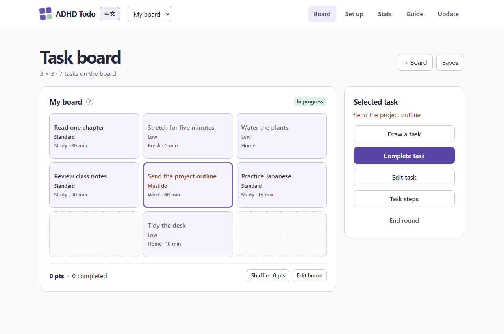

# ADHD Todo for Windows

[简体中文](#zh)

Double-click **ADHD Todo.exe** on a Windows x64 PC with Microsoft Edge installed. It opens the same task board in a dedicated window. The executable includes Python, the interface, and the SQLite runtime. Everyday use works offline. Close the window when you finish and open the executable to resume.

The first launch opens a full sample board. Choose **Start round → Draw a task** to let the board pick where to begin. Three squares say “Write my paper”. Placing several copies gives that project more chances in an eligible draw. When a Bingo feels like enough for today, choose **End round**. Unfinished tasks stay on the board for next time.



| What would you like to try? | Windows guide |
| --- | --- |
| Play one round, from setup to Bingo and the decision to stop | [First round in screenshots](docs/first-round.md) |
| Adjust weights, add steps, carry work over, restore a save and preview resets | [Detailed walkthrough](docs/detailed-walkthrough.md) |
| Understand how the board helps with starting, stopping and keeping several projects in play | [ADHD design notes](docs/adhd-design-notes.md) |
| Interpret the calendar, draw adoption and completion rates, or query your local data | [Board statistics and SQL](docs/metrics.md) |
| Compare six layouts and see the chance of Bingo after 3–7 completions | [Bingo probability study](docs/bingo-probability.md) |
| Test a change, refresh screenshots, prepare a release or review planned features | [Maintenance, release and changes](docs/maintenance.md) |

## Where your boards live

The default save is `%LOCALAPPDATA%\ADHD Todo\boards.sqlite`. Paste `%LOCALAPPDATA%\ADHD Todo` into File Explorer to find it. Updating or moving the executable keeps using this file. The adjacent `window` folder holds the dedicated Edge profile, including your language and chart preferences.

| What you want to move | In the original app | In Windows or the web app |
| --- | --- | --- |
| One board, with its current round and history | Saves → Download current board | Import a save → Add board |
| The entire workspace and its default board | Saves → Download all boards | Import a save → Replace boards |

Use **Saves** to back up while the app is open. Notes, images, placed tasks, steps, points, and statistics travel together. Existing web backups (v1–v3) and individual board transfers (v4) use the same import and confirmation screens. The hosted web app and this local file advance independently after transfer.

## Why reuse the interface and put the game in Python?

Consider confirming a 60-minute task. The same TypeScript dialog collects the confirmation on both platforms. In Windows it sends the operation, board ID, square and expected save revision to Python. Python reads the current board, checks the round and square, adds two points, records the completion and evaluates Bingo. SQLite commits these changes and the new revision together. The interface then renders the committed result. Two windows confirming from the same revision can produce only one completion.

| Boundary | What lives here | What it makes possible |
| --- | --- | --- |
| Shared TypeScript interface | Rendering, input, animation, task and settings forms, notes and image resizing, language, sample generation, archive validation, SQL reports | A layout or translation fix reaches both editions. Stats uses the same SQL views, filters and denominators in both. |
| Python board rules | Weighted draws and eligibility, scoring, line detection, success, shuffling, manual endings, day resets and transferring squares | Another interface can call the same actions. A script can exercise a fixed board and clock without opening a window. |
| Python SQLite storage | Actual board, round, completion and event tables, transaction boundaries and revision checks | A local reporting script can query durable records with ordinary SQLite. A failed write rolls back. No manual export is needed for a read-only local report. |
| Local entry point | A loopback HTTP service plus an Edge app window | Users get a double-click launch. Python and its assets ship together; the public website can still run on static hosting. |

The two editions have separate gameplay implementations. When a rule changes, update both and run the parity suite. Forms and validated imports currently send workspace snapshots, while gameplay sends individual commands. Stats computes its queries on the UI side from the saved state. The desktop database also exposes the same views to SQL tools.

**Future interfaces and cloud use.** A desktop integration or bot could call the Python rules and storage directly. For example, a Discord command could identify a board and issue the same completion command. A cloud service could reuse that operation and its transaction tests. It would also need authenticated users, board-level authorization, request deduplication for network retries, an explicit time zone for each board and a conflict policy for offline edits. A cloud API should limit snapshot replacement to an authorized restore operation. The current service binds to the local machine and uses a per-launch session token. It serves one Windows user's workspace.

## Build from source

From the repository root on Windows x64, install Node.js 24+, Python 3.11+ with SQLite, and Microsoft Edge. The packaged build was tested with Python 3.14 and PyInstaller 6.18. Run in PowerShell:

```powershell
npm.cmd ci
py -m venv windows/.build/env
$python = (Resolve-Path windows/.build/env/Scripts/python.exe).Path
& $python -m pip install PyInstaller==6.18.0
.\windows\build.ps1 -Python $python
```

The executable is written to `windows/out/ADHD Todo.exe`. To run the source directly, use `npm.cmd run build:windows`, then `py windows/app.py`. The default local port is 4176. If another program owns it, pass `--port 4180`. For isolated test data pass `--data-dir PATH`. The optional `--serve-only` flag runs the same service without launching a window.

## Verify a change

Run these from the repository root after building. The UI and package checks open Edge with disposable data directories. The package check opens and closes real desktop windows.

```powershell
npm.cmd test
py windows/test_rules.py
py windows/test_ui.py
py windows/test_package.py
```

The rule suite compares intermediate Python and TypeScript board states, rollbacks and competing completions. The UI suite reuses the web app's browser scenarios. The package suite transfers an open round both ways, compares the Board, Set up and Stats renderings on the same data, and checks the disk save after closing and reopening the executable.

<a id="zh"></a>

# ADHD Todo Windows 版

在装有 Microsoft Edge 的 Windows x64 电脑上，双击 **ADHD Todo.exe** 即可打开独立棋盘窗口。程序自带 Python、前端资源和 SQLite，日常使用可以离线。用完直接关窗，下次双击继续。

首次启动会打开满盘示例。点**开始本轮 → 抽一项任务**，让棋盘帮你决定从哪里开始。示例里有三个格子都叫「Write my paper」：想多做写论文这件事，就可以多放几份，增加它在符合条件时被抽中的机会。连成 Bingo 后，如果觉得今天可以收工了，就手动结束。未完成的事下轮还能接着做。


| 想体验什么 | Windows 版文档 |
| --- | --- |
| 从摆盘开始，试一次抽选、连线和手动收工 | [第一轮试玩图解](docs/first-round.md#zh) |
| 调整权重、拆步骤、跨轮续做、迁移存档、预览三种重置 | [详细操作图解](docs/detailed-walkthrough.md#zh) |
| 了解棋盘怎样帮助启动、安心收工、同时推进几个项目 | [ADHD 设计说明](docs/adhd-design-notes.md#zh) |
| 看懂日历、首抽采纳与完成率，或查询本地记录 | [统计指标与 SQL](docs/metrics.md#zh) |
| 比较六种摆法，看看做完 3–7 项时的连线概率 | [Bingo 概率研究](docs/bingo-probability.md#zh) |
| 修改后验收、更新截图、准备发布，或查看后续功能 | [维护、发布流程与更新记录](docs/maintenance.md#zh) |

## 存档位置和互导

默认存档为 `%LOCALAPPDATA%\ADHD Todo\boards.sqlite`。将 `%LOCALAPPDATA%\ADHD Todo` 粘贴到文件资源管理器地址栏即可找到。移动或替换 exe 后依然读取这份文件。同目录的 `window` 是专用 Edge 配置，保存语言和图表等界面偏好。

| 想带走什么 | 在原来的程序里 | 在 Windows 或网页版里 |
| --- | --- | --- |
| 一个棋盘、它进行中的轮次和历史 | 存档 → 下载当前棋盘 | 导入存档 → 添加棋盘 |
| 全部棋盘和默认棋盘选择 | 存档 → 下载所有棋盘 | 导入存档 → 替换棋盘 |

开着程序时可直接通过**存档**菜单做备份。任务、步骤、文字与图片备注、点数和统计会一起带走。网页版旧备份（v1–v3）和单棋盘文件（v4）沿用相同的导入及确认流程。迁移后，两端各自记录新的进度。

## 为什么复用界面，让 Python 负责玩法

以确认完成一个 60 分钟任务为例。两个版本弹出同一个 TypeScript 确认框。Windows 版把操作、棋盘 ID、格子位置和它看到的存档版本交给 Python。Python 读取当前盘面，确认这一轮仍然有效、这一格仍待完成，加 2 点、记录完成、判断 Bingo。SQLite 把这些变化和新版本号一次提交，界面收到结果后再点亮格子。即使两个窗口同时确认同一格，也只会成功一次。

| 部分 | 具体负责什么 | 为何值得分开 |
| --- | --- | --- |
| 共用 TypeScript 界面 | 页面、操作反馈、动画、任务与设置表单、备注图片缩放、双语、示例、存档校验、SQL 报表 | 修改布局或译文时两版一起生效。统计使用相同的查询、筛选条件和分母。 |
| Python 棋盘规则 | 候选和加权抽选、计分、判线、成功、打乱、手动结束、按棋盘日重置、主格放置和撤回 | 新入口可以直接调用业务操作。给定相同盘面和时间，测试可以在没有窗口时逐步核对结果。 |
| Python SQLite 存储 | 读写棋盘、轮次、完成和事件表，执行事务并检查存档版本 | 本机脚本可以查询一份固定的 SQLite 文件，生成周报时不必每次导出。事务中途出错会回滚。 |
| 本机启动入口 | 仅监听本机的 HTTP 服务和独立 Edge 窗口 | 用户双击即可用。Python 和资源随程序分发，公开网页版仍能使用静态托管。 |

这套架构也有维护成本。两个版本各有一份玩法实现，规则变化时需要一起改，并用同一盘面跑对照测试。目前对局发送单个操作，表单编辑和已校验的导入通过工作区快照保存。Stats 根据已保存的状态，在界面侧运行共享 SQL 查询；桌面数据库也向本地 SQL 工具提供相同的统计视图。

**后续加接口和上云。** 将来如果做桌面插件或机器人，可以在新入口调用现有 Python 规则和存储。例如 Discord 指令选定棋盘后，可以调用同一个「完成这格」操作。迁移到云端也能沿用这些操作和事务测试。真正做跨端同步时，还要补上登录、每块棋盘的访问权限、网络重试去重、每块棋盘的明确时区，以及离线修改冲突的处理规则。云 API 还应将整份快照替换限制在已授权的恢复操作。当前服务只监听本机，用每次启动生成的令牌访问当前 Windows 用户的数据。

## 从源码构建

在 Windows x64 电脑上安装 Node.js 24+、自带 SQLite 的 Python 3.11+ 和 Microsoft Edge。本次打包使用 Python 3.14 和 PyInstaller 6.18。在仓库根目录打开 PowerShell，执行：

```powershell
npm.cmd ci
py -m venv windows/.build/env
$python = (Resolve-Path windows/.build/env/Scripts/python.exe).Path
& $python -m pip install PyInstaller==6.18.0
.\windows\build.ps1 -Python $python
```

生成的文件位于 `windows/out/ADHD Todo.exe`。源码试玩可直接运行 `npm.cmd run build:windows`，然后运行 `py windows/app.py`。默认本机端口为 4176，若已被其他程序占用，可以加 `--port 4180`。需要隔离测试存档时加 `--data-dir 路径`，只启动服务时加 `--serve-only`。

## 修改后怎样验证

构建后在仓库根目录执行。界面和打包测试都使用临时数据。打包测试会真实打开、关闭桌面窗口。

```powershell
npm.cmd test
py windows/test_rules.py
py windows/test_ui.py
py windows/test_package.py
```

规则测试逐步对照 Python 和 TypeScript 的盘面，并验证写入回滚和同时确认同一格。界面测试直接复用网页版的浏览器操作脚本。打包测试在两端互导进行中的轮次，用同一份数据比较主板、摆盘、统计的画面，并在关闭和重开 exe 后检查磁盘存档。
