# ADHD Todo for Windows · Detailed walkthrough

[Jump to the Chinese edition](#zh)

For a quick introduction, [play your first round](first-round.md). This guide follows one board, *Writing break*, from choosing draw weights to resuming a half-finished paragraph in the next round.

[Set up the writing board](#setup) · [Understand the draw](#draw) · [Split a task and resume it](#steps) · [Check Stats and transfer an open round](#saves) · [Preview the three resets](#reset) · [Carry unfinished work into the next round](#carryover)

## Set up the writing board

In **Set up → Random fill**, choose how many empty squares to reserve for everyday tasks (default 6, capped at the number of empty squares). On a board with nine empty squares, choosing six reserves three for one-offs. Each library draws its Must-dos first, randomly if there are too many. Standard and Low have equal chances during filling. Each library entry is picked at most once per fill. If a library runs short, its spare squares stay empty.

On any board, the question marks beside **Day starts at**, **Side length** and **Group by row** explain what each setting changes. Hover over the question mark, focus it with Tab, or tap it. You can also read the size explanation during an open round, when the size is locked.

Choose **+ Board** and name the new board *Writing break*. In **Set up → Board settings**, select **Default board** to reopen it on your next visit. Set **Day starts at** to 06:30 local time. A round started at 06:29 will belong to the previous day. Give Standard tasks 3 tickets and Low tasks 1. The preview shows 75% and 25% for one of each. Choose **Save settings**.

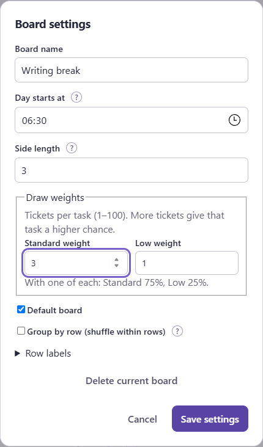

Add *Draft a paragraph* (Standard, 30 min) and *Stretch* (Low, 5 min) to **Everyday library**. After saving each task, click a square in the top row to place it. Add *Send the outline* (Must-do, 60 min) in **One-off library** and place it in the center. Look back at the libraries. You can place another copy of the paragraph, while the outline has moved out of its library slot.

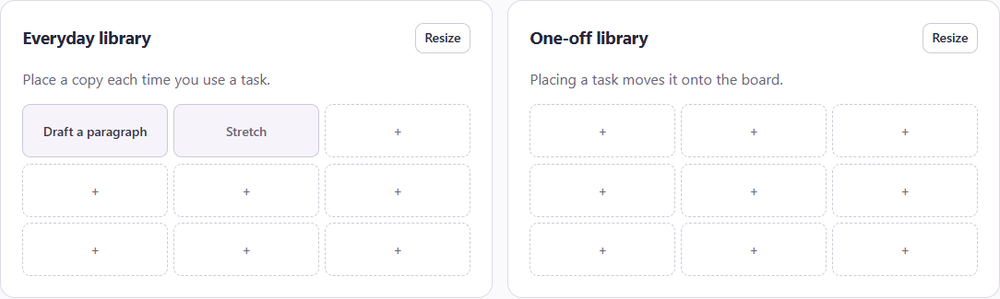

## Understand the draw

Choose **Start round**, then open **Guide**. In **How the draw works**, read **This board**. The outline is the only Must-do. Its chance is 100% and the other two tasks each have a 0% chance.

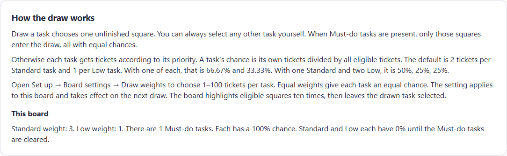

Return to **Board** and choose **Draw a task**. Once you have sent the selected outline, choose **Complete task**. Check the name in the dialog and confirm. The center square becomes a checkmark and its 60 planned minutes earn 2 points.

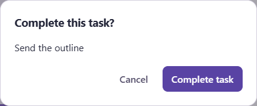

Reopen **Guide**. The paragraph now gets three of the four tickets, and stretching gets one. Another draw would use those odds. For the next step, select the paragraph yourself on **Board**.

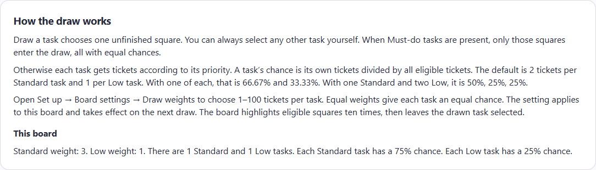

## Split a task and resume it

Right-click *Draft a paragraph* and choose **Task steps**. On a touchscreen, tap the square and find **Task steps** below the board. Choose **Edit task** to change the parent’s properties. **Add note** (or **Edit note** for an existing note) lets you add text, web links and an image. Open the note card to follow a link. **Copy task** puts a separate copy in the task’s library. In Set up, drag a library task into the other library to change its type. **Delete task** asks for confirmation before discarding just this placement.

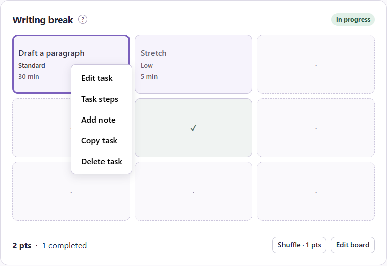

Keep the default **Side length** of 2. Enter *Write a topic sentence* in Step 1 and *Add an example* in Step 2. Leave the other squares empty. Choose **Save steps**, then reopen **Task steps**.

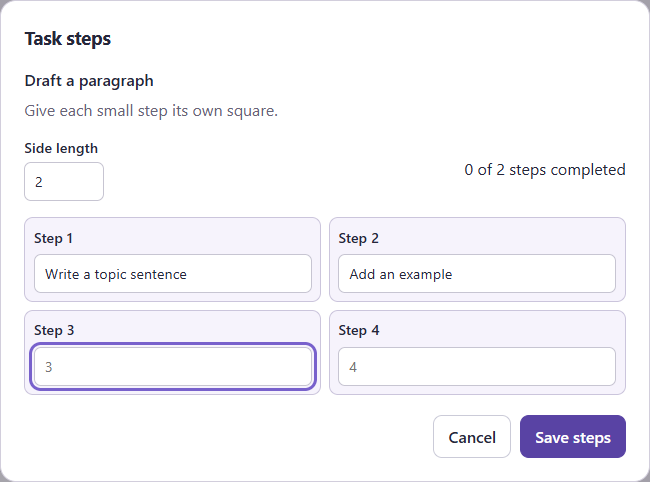

Select the topic sentence and choose **Complete step**. The dialog names the step you are about to clear. Choose **Confirm completion** once the sentence is written.

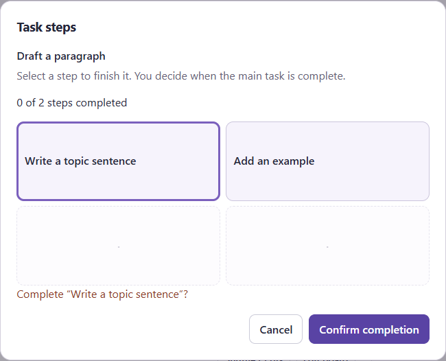

**1 of 2 steps completed** counts the two named steps. The first square has a checkmark and *Add an example* is still visible. Choose **Close**.

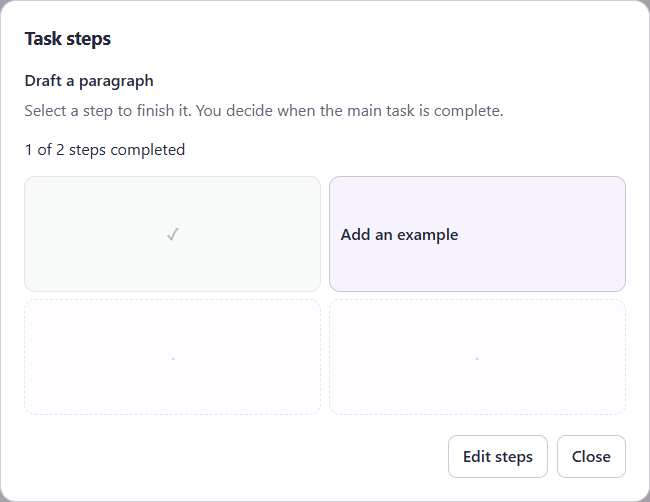

Refresh, then select the paragraph again. The board says **In progress**, **2 pts** and **1 completed**. Only the outline earned points. You can close the window and reopen the executable under the same Windows account to continue this round.

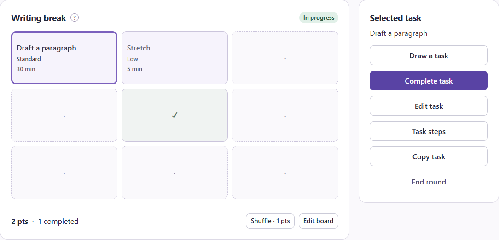

## Check Stats and transfer an open round

Open **Stats** and expand **Completion log**. *Send the outline* has one completion. The entry shows the time, 60 planned minutes and **+2**. The round day still says **In progress**.

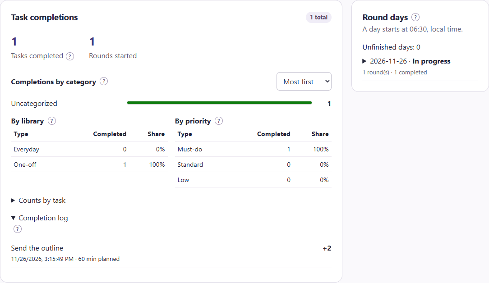

To bring only this board into another copy of the app, choose **Download current board**, then **Import a save → Add board** at the destination. To follow the full-backup example below, choose **Saves → Download all boards**. Transfer the downloaded SQLite file to the device or browser where you want to continue. It includes the open round and the paragraph's step progress.

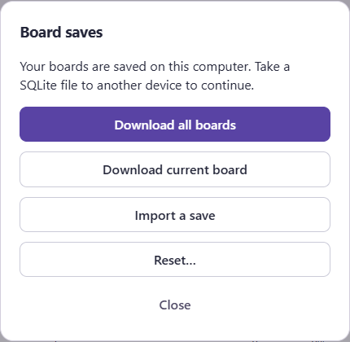

In the destination app choose **Saves → Import a save** and select the file. Check its name and board count. **Replace boards** replaces all boards in the destination workspace, so download its existing boards first if you want to keep them. In our fresh Windows workspace, the import restored 2 points, the open round and the completed topic sentence.

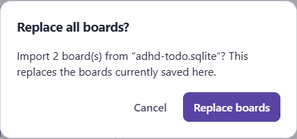

## Preview the three resets

On the imported board, open **Saves → Reset…**. Check the board name. Each option opens a separate confirmation. To follow the tour, choose **Cancel** after reading each one.

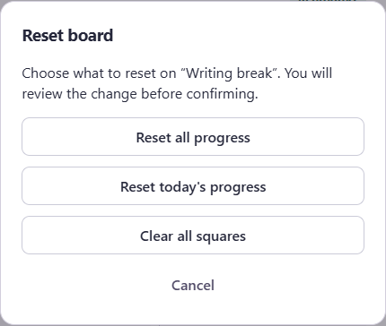

**Reset today's progress** identifies the board day and resulting balance. This board earned its only 2 points in today's open round, so the preview says **0**. Confirming would put the outline back in the center and reopen the topic-sentence step in the paragraph.

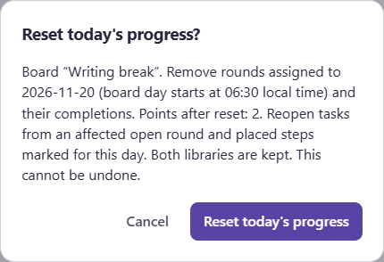

**Reset all progress** covers every day on this board. It erases rounds and completions, resets points to zero, restores completed tasks from the open round and reopens placed task steps. Both libraries are kept.

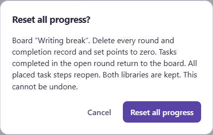

**Clear all squares** empties the main grid, including placed one-offs and their steps. It closes any open round with its current result. Points, history and libraries are kept. Cancel here too so you can try ordinary end-of-round carryover.

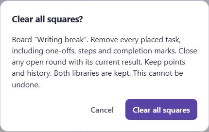

## Carry unfinished work into the next round

Return to **Board**, choose **End round** and confirm. **Set up** now says **Between rounds**. The center is empty, the two unfinished tasks stay in place, and the balance is still 2. Choose **Start round**, select the paragraph and open **Task steps**. The topic sentence is still checked. Pick up at *Add an example*.

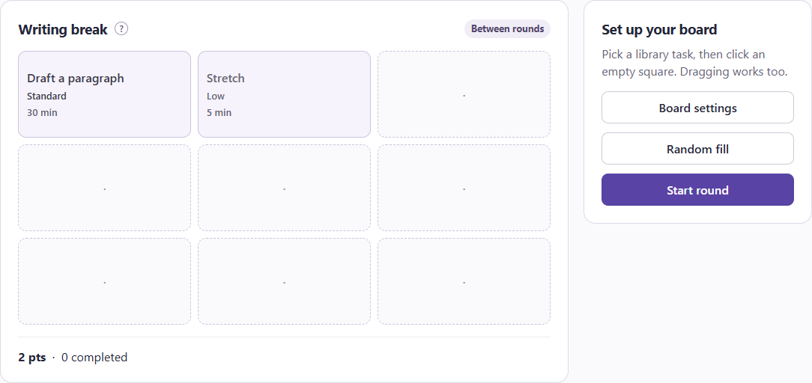

---

# ADHD Todo Windows 版详细操作图解

第一次玩可以先看[第一轮快速指南](first-round.md#zh)。这里用一块叫 *Writing break* 的棋盘，从设置权重一直玩到下一轮接着写。图中使用英文界面，文中保留相应的按钮名称。

[摆一块写作棋盘](#setup-zh) · [看懂抽选结果](#draw-zh) · [拆成小步骤，中途回来接着做](#steps-zh) · [查看统计，迁移进行中的轮次](#saves-zh) · [看清三个重置选项](#reset-zh) · [收工后从剩下的步骤继续](#carryover-zh)

## 摆一块写作棋盘

在**摆盘 → 随机填充**中，选择给日常任务预留几个空格。默认 6 格，空位不足 6 格时取实际空位数。比如主板有 9 个空格，选 6 个日常，就给临时任务留 3 格。各库分别优先抽必做，必做超额就随机选；剩下的标准和低优先级等概率。一次填充中每个库格最多入选一次，某库任务不够就留空。

所有棋盘的 **Day starts at**（一天的开始时间）、**Side length**（每边格数）和 **Group by row**（按行分组）旁都有问号。鼠标移到问号上、用 Tab 聚焦它或轻点它，都能查看说明。进行中的轮次锁定尺寸，仍可查看每边格数的说明。

点 **+ Board** 新建棋盘，命名为 *Writing break*。在 **Set up → Board settings** 中勾选 **Default board**，下次打开应用就会回到这块棋盘。把 **Day starts at** 改成当地时间 06:30；这样 06:29 开始的轮次仍归前一天。把 **Standard weight** 设为 3，**Low weight** 设为 1。预览显示两类任务各有一项时的概率为 75% 和 25%。点 **Save settings**。

在 **Everyday library** 添加 *Draft a paragraph*（写一段，Standard，30 分钟）和 *Stretch*（伸懒腰，Low，5 分钟）。每次保存后点主板第一行的一格。在 **One-off library** 添加 *Send the outline*（发提纲，Must-do，60 分钟），放到正中央。回看任务库：段落还可再取一份，提纲原来的库格已经腾空。

## 看懂抽选结果

点 **Start round**，打开 **Guide**，在 **How the draw works** 下看 **This board**。提纲是唯一的 Must-do，所以被抽中的概率是 100%，另外两项都是 0%。

回到 **Board** 点 **Draw a task**，会选中中央的提纲。发完提纲后点 **Complete task**，核对框里的任务名再确认。中央格变成勾，这项预计 60 分钟的任务获得 2 点。

再打开 **Guide**。现在写段落占四票中的三票，伸懒腰占一票。如果再抽，就按 75% 和 25% 来选。接下来回到 **Board**，手动选中写段落的格子。

## 拆成小步骤，中途回来接着做

右键点 *Draft a paragraph*，选 **Task steps**。触屏上可以点中该格，再滑到棋盘下方找 **Task steps**。同一菜单里的 **Edit task** 用来改主任务的属性。点 **Add note** 可以加文字、网址和图片，打开备注卡片就能点击链接，已有备注时入口叫 **Edit note**。点 **Copy task** 会在对应库里新建独立副本。在摆盘页，把一个库中的任务拖到另一库即可转换类型。**Delete task** 会先让你确认，再删除这一格的任务。

保留 **Side length** 的默认值 2。第一格填 *Write a topic sentence*（写一句主题句），第二格填 *Add an example*（加一个例子）。其余两格留空。点 **Save steps**，再打开 **Task steps**。

选中主题句，点 **Complete step**。画面会指出即将完成的是哪一步。写好这句后，点 **Confirm completion**。

**1 of 2 steps completed** 里的分母是写过名字的两步。第一格已经变成勾，*Add an example* 仍然可见。点 **Close** 返回。

刷新并重新选中段落。棋盘仍显示 **In progress**、**2 pts** 和 **1 completed**。发点的是提纲这项主任务。想休息可以直接关窗，之后用同一 Windows 账户双击程序继续本轮。

## 查看统计，迁移进行中的轮次

打开 **Stats**，展开 **Completion log**。*Send the outline* 有一条完成记录，里面有完成时间、预计 60 分钟和 **+2**。当天的状态仍是 **In progress**。

只想迁移当前棋盘时，可点 **Download current board**，再到目标程序选择 **Import a save → Add board**。要跟着下面的图解恢复完整备份，点 **Saves → Download all boards**，把下载的 SQLite 文件传到准备继续使用的设备或浏览器。文件里包括进行中的轮次和段落的小步骤进度。

在目标程序打开 **Saves → Import a save** 并选择文件。核对文件名和棋盘数量。**Replace boards** 会替换目标程序里的全部棋盘；想保留原进度，可以先下载一份。这次实际导入后，2 点余额、未结束的轮次和已完成的主题句都恢复了。

## 看清三个重置选项

在刚导入的棋盘打开 **Saves → Reset…**，核对棋盘名。点进任何一项都会先进入单独的确认画面。跟着看图时，每次读完点 **Cancel** 就好。

**Reset today's progress** 会显示轮次日及重置后的余额。本例仅有的 2 点来自当天进行中的轮次，因此预览是 **0**。若确认，提纲会回到中央格，段落里的主题句这一步也能重做。

**Reset all progress** 涵盖这块棋盘的所有日期。它会清除轮次和完成记录、将点数归零、恢复进行中轮次已完成的任务，并重新开放主板上的任务步骤。两个任务库保留。

**Clear all squares** 会清空主板，也包括已摆上去的一次性任务和步骤。进行中的轮次按当前结果收工，点数、历史和任务库保留。这里也点 **Cancel**，接下来看正常收工后会怎样。

## 收工后从剩下的步骤继续

回到 **Board** 点 **End round** 并确认。**Set up** 显示 **Between rounds**：中央格已腾空，两项未完成任务留在原格，余额仍为 2 点。点 **Start round**，选中段落再打开 **Task steps**，主题句仍为完成状态，可以直接从 *Add an example* 接着做。

