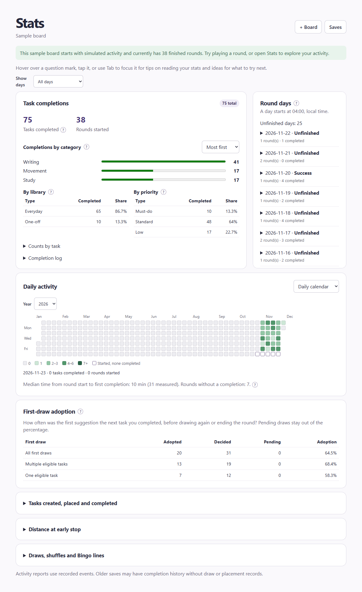
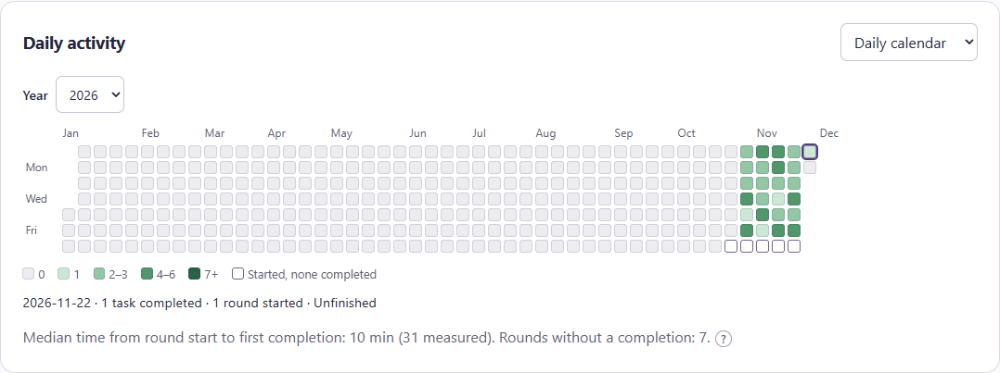

# Board statistics

[中文版](#zh)

Stats can help you decide what to put on the board, how much to take on, and whether to draw or pick a task yourself. Hover over, focus or tap a **?** beside a metric for a short reading tip.

The full-grid sample has 30 simulated days, 38 finished rounds and 75 completed tasks. Each round starts with nine occupied squares, including tasks carried over from the previous round. New Must-do tasks can appear in any available square. Choose **Board → Start round**, finish one task and return to **Stats** to see the total reach 76. The starting grid has three copies of “Write my paper”. Older full-grid and project demos are replaced on upgrade. Demos with personal edits are kept as separate practice boards.

The heatmap counts draws in this example. The centre was drawn 12 times in 81 draws, including 2 first draws in 31 rounds with a draw. The separate probability study calculates the chance of a line after 3–7 completions for six layouts and choice strategies, including a Must-do in the centre.



## Task choices and completions

| Metric | What you might ask and how to use the answer | Counting rule | Display |
| --- | --- | --- | --- |
| Total completions | What did I finish this week? Include early-stop days when looking back. If a week felt unproductive, open the log and pick out one thing you are glad you finished. | Count each confirmed main-board task once, including work in an open round. The day-outcome filter uses its round’s start day. Steps contribute through their parent. | Total at the top |
| Completions by category | Which parts of my life got attention? Compare the mix with what mattered to you that week. If a category you care about has few finishes, check whether you put any of its tasks on the board before changing your plan. | Use the category saved at completion. A blank category appears as Uncategorized. The chart includes categories with at least one completion. Its counts sum to the total. | Sorted bars with exact counts |
| Everyday and One-off shares | How much of my finished work was routine? If one-offs account for most finishes, check how many everyday tasks you placed. If you wanted more routine practice, try reserving one square for a small everyday task. | Divide completions from each library by all completions in the selection. Five everyday completions out of eight give an everyday share of 62.5%. | Counts and percentages |
| Shares by priority | Did I make room for things I wanted to do? If Must-do tasks account for most finishes, review which ones really had a deadline. If you miss doing something less urgent, try selecting it yourself next round. | Group by each square’s priority at completion. All three groups use the same denominator of completed tasks. | Counts and percentages for Must-do, Standard and Low |
| Tasks created and placed | Which ideas stay in my library? Compare the library ideas you saved with the tasks you actually put in play. If a category keeps growing in the library, try placing one small task from it before adding another. | Count new library task IDs and new placement IDs separately, including groups with placements and zero completions. | Category, library and priority counts |
| Placement completion rate | How much of last week's plan have I finished? Compare batches that have had about the same time to finish. If older batches still have many tasks on the board, try placing fewer next time. If many were removed, review which tasks stopped mattering to you. | Group placements by date first put on the board. Count distinct placements completed by the observation date, still on the board, or removed. Returning a task to its library and deleting its square both count as removals. Compare categories, libraries and priorities as recorded at placement. | Cohort table with dates, counts and rates |
| Counts by task and completion log | What do I reliably return to? Look for a task you repeatedly manage to start and finish. Its wording or small first step may give you a template for a similar task you keep putting off. | Group by the original library task ID. Two copies of one library task contribute two completions if both are finished. Separate tasks may share a name. Each log entry keeps the title, planned minutes and points at completion. | Expandable task counts and timestamped log |

A completion share describes the mix of finished work. To learn whether everyday tasks tend to stay on the board longer, we also need to count everything placed there. Open **Tasks created, placed and completed** for that denominator. For example, five completions from eight placements give a completion rate of 62.5% for that intake period.

The day-outcome filter applies to the day recorded at creation or placement. **From** and **Through** include both endpoints. An outcome is observed through today, even if the task finished on a different day. A task carried over three rounds keeps one placement. Two copies get two placements. If a reset removes the evidence for an outcome, the table can show Unknown. Counts before event recording began are unavailable. Heatmaps show observed counts and depend on task eligibility and board layout.

## Round pace and stopping

| Metric | What you might ask and how to use the answer | Counting rule | Display |
| --- | --- | --- | --- |
| Daily activity | Which days did I make time for even one task? Hover over a square to see what you completed, including days when you continued an earlier round. | Each main task belongs to the local board day when you confirmed it. Round starts and their outcomes use their saved start day. The day filter selects rounds by their start-day outcome. Older completions use their timestamp and the board’s day boundary when loaded. | **Daily calendar** is the default, with one column per week. Choose **Per-round bars** for the round view. Hover, focus or tap a date for counts and the outcome of rounds started that day. |
| Tasks per finished round | How much fits in one round? Use the median as a starting point for the next board. If a few unusually long rounds lift the average, plan around an ordinary round and add more only if you feel like continuing. | Count each ended round, including zero. The average includes every such round. The median is the middle count, averaging the middle two for an even sample. Show tied modes or indicate when no count repeats. | One bar per round, oldest first, plus average, median and mode |
| Round days | What rhythm worked for me on a busy day? Expand a successful day and an unfinished day. If several short rounds suited you on the successful day, try that rhythm again on a day with little uninterrupted time. | A round belongs to the local board day on which it started. Any successful round makes that day successful. Otherwise a day with an open round is in progress. When every round ended early it is unfinished. Days without starts are omitted. | Filter the report by day outcome. Expand a date for **all** its rounds, including an early stop on a successful day. |
| Time to first completion | How long until I have a first finish? Look at the median alongside rounds without a finish. If the first finish often takes longer than you expected, recall any breaks, then try a smaller opening task and see how the next few rounds feel. | Subtract round start from first confirmed completion. Report rounds without a first completion separately. Elapsed time includes breaks. A future timer could measure active work. | Median elapsed time and count of rounds |
| Distance when stopping | How close was I when I called it a day? Compare early stops with all finished rounds. If you often stop several tasks short, the workload may exceed the time you have. Try fewer tasks or a smaller first step. If you usually stop one short, consider whether stopping there already suited you. | At manual close, use the fewest further completions on that layout: clear all remaining tasks, or complete a feasible line and every remaining Must-do. Count overlaps once. An originally empty square blocks a line. A reached goal has distance zero. | Distribution for early-stop rounds |



## Draws and board layout

| Metric | What you might ask and how to use the answer | Counting rule | Display |
| --- | --- | --- | --- |
| First-draw adoption | Does a suggestion help me choose? Focus on rounds with multiple eligible tasks. If you often pass on the first suggestion, recall what you wanted to do when it appeared. If another task kept coming to mind, try choosing it directly and see which way helps you start. | For each round with a revealed draw, match its first suggestion to the next confirmed main task by placement ID. Count it as adopted if it is completed before another draw or the end. Show pending rounds separately and split single-candidate draws from draws with a choice. | Counts and share, with the sample size |
| Draws, shuffles and Bingo locations | Where does the draw land, and when do I ask again? Compare boards of the same size. A frequently drawn square may often hold an eligible Must-do. If the same Bingo line recurs, try moving tasks between rounds. If you often redraw before finishing even one square, see whether picking your first task yourself feels easier. | Separate first draws from all revealed draws. Group draws and shuffles by completed-square count. A redraw is a draw following another draw in the same round with no intervening completion. Count each distinct line once per round. Split layouts by size and interpret draws in light of eligibility and priority. | Grid heatmaps and a frequency table |

## What the save records

Each trip from a library to the board gets a **placement ID**. Place “Read one page” twice and each copy can be followed separately. Carry the second copy into tomorrow or shuffle it to a different square and it keeps its ID. This lets a later query match a draw to the exact copy completed and count a carried task only once.

A downloaded SQLite file (full backup or single board) includes `day_metrics`, `round_metrics`, `completion_metrics`, `draw_sequence`, `first_draw_metrics` and `placement_metrics`. The `board_events` table records task creation, placement, removal, revealed draws, confirmed completions, applied shuffles and round endings. Event details include the selected position and eligible count on a draw, the completed lines after a completion or shuffle, and the remaining distance at round end. Animation flashes are excluded. Records stay on the device unless you export the save. Resetting progress affects the available history. Older files retain their observed rounds and completions. Measures that require placement or draw events can start only where those events were recorded.

On Windows the live database also exposes these views. In a PowerShell window with the SQLite CLI installed, open it with `sqlite3 -readonly "$env:LOCALAPPDATA\ADHD Todo\boards.sqlite"`. You can also open an exported file. Run the following queries in either database. Each result identifies its board so a sample and a personal board can be inspected separately.

```sql
SELECT b.name, c.board, c.category, COUNT(*) AS completed
FROM completion_metrics AS c JOIN boards AS b ON b.id = c.board
GROUP BY c.board, c.category
ORDER BY b.name, c.board, completed DESC, c.category;

SELECT board, day, day_status, COUNT(*) AS rounds, SUM(completed) AS completed
FROM round_metrics
GROUP BY board, day, day_status
ORDER BY board, day DESC;
```

These two queries reproduce first-draw outcomes and placement completion rates per board in a newly exported save.

```sql
SELECT board, outcome, COUNT(*) AS first_draws
FROM first_draw_metrics GROUP BY board, outcome;

SELECT board, day, COUNT(*) AS placed, SUM(outcome='Completed') AS completed,
       ROUND(100.0 * AVG(outcome='Completed'), 1) AS completion_pct
FROM placement_metrics GROUP BY board, day ORDER BY board, day;
```

## Planned personal insights

Today the question marks give general reading tips. In a future version, scripts will calculate metrics and sample sizes for the selected board. An optional AI API will use those results to explain patterns and suggest something to try, such as placing fewer tasks if older batches regularly remain unfinished.

## Experiment and simulation

One product question is whether making **Draw a task** easier to find helps someone take a first step. A possible experiment would keep the rules and manual choice identical, assign consenting participants to the existing or more prominent button for the whole trial, and compare the share of started rounds with at least one completion within 24 hours of start and before round end. Include rounds with no draws and zero completions. Allow a full 24 hours of observation and account for multiple rounds from one participant. First-draw adoption can help explain the result. This is a proposed design. The sample contains synthetic activity and supplies no evidence of a benefit for ADHD.

The playable sample uses a fixed random seed. A separate Python study measured the chance of a Bingo by the third through seventh completion across six layouts and choice policies. On the full board with equal weights, the chance is 38.10% by the fourth completion and 77.78% by the fifth. [Results and reproducible Python script](bingo-probability.md)

---

<a id="zh"></a>

# 棋盘统计

可以用 Stats 想一想，下轮想摆哪些任务、摆多少，以及让程序抽还是自己选。把鼠标移到指标旁的 **?** 上，用键盘聚焦，或在触屏上轻点，就能看到一条解读提示。

满盘示例有 30 个模拟使用日、38 个已结束的轮次，共完成 75 项。每轮开始时九格都摆有任务，其中包括上一轮留下的任务。新增必做任务可以放在任一待补空格。点「棋盘 → 开始本轮」，做完一项再回「统计」，总数会变成 76。开局时有三份同名的「写论文」。升级会替换旧满盘和小任务示例；有个人修改的示例会作为单独的练习棋盘保留。

热力图统计这份示例里实际抽中了哪里。总共抽选 81 次，中心被抽中 12 次；有抽选记录的 31 轮中，首抽命中中心 2 次。独立的概率研究计算六种布局与选择策略下做完 3 至 7 项时的连线概率，其中一种情形是把唯一的必做任务放在中心。


## 任务选择与完成情况

| 指标 | 用户想知道什么、为什么值得看 | 统计口径 | 展示方式 |
| --- | --- | --- | --- |
| 完成总量 | 这周我究竟做成了多少事？觉得这周没做成什么时，把提前收工的日子也算进来，从明细里找一件庆幸自己完成了的事。哪怕当时没连成 Bingo，那份进展也算数。 | 每次手动确认完成一个主格记一项，进行中轮次也计入。按成功日或未完成日筛选时，以该轮开始日的结果为准。子步骤不另计。 | 顶部总数 |
| 各分类完成量 | 这周哪些事情得到了照顾？对照这周自己在意的事看各类完成数。如果很想做的一个分类完成得少，先看它有没有上板，再决定是给它留一格，还是把已经上板的任务拆小。 | 按完成当时的分类计数。空分类归入 Uncategorized。列出至少完成过一次的分类，各类加总等于完成总量。 | 可按多少排序的条形图和各分类的完成件数 |
| 日常与临时任务的完成占比 | 日常习惯有没有被临时事项挤掉？如果做完的大多是临时事项，先看日常任务实际摆了几份。若这周本想多练一个习惯，可以给它留一格，放一项今天就做得完的小任务。 | 分母为所选日期的全部完成项，分子为来自相应库的完成项。例如共完成八项，其中五项来自日常库，日常占比为 62.5%。 | 两类的完成数与百分比 |
| 各优先级完成占比 | 除了必做的事，我给自己想做的事留了多少空间？如果做完的大多是 Must-do，回看哪些确实有期限。若有一件不紧急但自己很想做的事，下轮可以手选它，看看是否更容易开始。 | 以主格完成当时的优先级分组，分母均为已完成任务总数。 | Must-do、Standard、Low 各自的件数与占比 |
| 新建量与上板量 | 哪些想法记下了，却很少拿出来做？对照“记进库里”和“真的摆上棋盘”的数量。如果某类想法越记越多却很少上板，下次再记一项之前，可以先挑其中最小的一项试做。 | 新建用库任务 ID，上板用独立上板 ID，各自计数。有上板但零完成的分组也保留。 | 分类、任务库、优先级的计数表 |
| 上板任务完成率 | 上周摆上去的任务，到今天完成了多少？选两批已经留出相近完成时间的任务来比较。如果较早摆上的一批至今还有许多留在板上，下次可以少摆几项；如果很多是自己移除的，回想当初的计划是否还值得做。 | 按首次上板日期圈定一批任务，按独立上板 ID 统计截至观察日已完成、仍在板上、已移除的份数。退回任务库和直接删除主格任务均计为移除。可按上板时的分类、任务库和优先级比较。 | 带上板日期、观察日期、件数与完成率的表格 |
| 单项累计与完成明细 | 哪些小事我已经做成过好几次？找一件自己反复做成的小事，翻看它当时是怎么写的。比如“读一页”比“复习”更容易着手，可以借用这个写法，把另一件总拖着的事写成一个具体动作。 | 按原始库任务 ID 累计。同一日常任务上板两份，各做完一次就累计两次。同名的独立任务分别累计。明细保存完成时的名称、计划时长和点数。 | 可展开的任务计数和带时间的明细 |

完成占比能解释“做完的事情由哪些部分组成”。要知道日常任务是否更容易留在板上，还要数清当初一共摆上了多少份。展开 **Tasks created, placed and completed** 就能查到这个分母。例如某段时间上板的八份任务到今天完成了五份，这一批的完成率就是 62.5%。

成功日和未完成日筛选按新建或上板事件记录的棋盘日生效。**From** 和 **Through** 包含起止两天。完成情况观察到今天，即使在另一天完成也归回最初那一批。留了三轮的一份只算一次上板，同一任务摆两份算两次。重置导致去向记录缺失时，表中可能显示 Unknown。开始采集之前的抽选和上板量无法追溯。热力图显示观察到的次数，解读时要考虑哪些格子曾有任务、哪些任务有资格被抽到。

## 轮次节奏与收工

| 指标 | 用户想知道什么、为什么值得看 | 统计口径 | 展示方式 |
| --- | --- | --- | --- |
| 每日活动 | 哪些日子我抽空做成了哪怕一件事？回看颜色较浅的格子，也能看到继续前几天轮次时完成的任务。 | 主格按确认完成时的本地棋盘日计数，轮次及其结果仍按开始日归属。成功日或未完成日筛选按轮次开始日的结果选择记录。旧档由完成时间戳和读取时的棋盘分日设置还原。 | 默认使用 **Daily calendar**，每列一周，也可切换到 **Per-round bars**。悬停、聚焦或轻点日期，查看完成项数、开始轮数和这些轮次当天的结果。 |
| 每轮完成量 | 一轮摆多少比较合适？为下一轮摆任务时，可以先参照中位数。如果平均数被少数做得特别多的轮次拉高，就按平常一轮的量来摆，有余力再继续。 | 每个已结束的轮次都计入，包括零完成的轮次。平均数按轮计算，偶数轮的中位数取中间两项的平均。众数并列时全部列出，没有重复时明确标示。 | 按时间顺序每轮一根柱，附平均数、中位数、众数 |
| 按天查看各轮 | 忙碌的日子里，我适合怎样安排轮次？各展开一个成功日和一个未完成日，看看当时是一次做完，还是收工后又开了一轮。如果几段短轮次更适合自己，下次时间零碎时就可以这样安排。 | 轮次按点击开始时的本地棋盘日归属。一天有一轮成功即为成功日，否则有未结束的轮次即为进行中，所有轮次均提前结束才为未完成日。没有开始的日子不计。 | 按天的结果筛选整份报告。点开某日能看到当天**所有轮次**，包括成功日里提前结束的轮次。 |
| 从开始到首次完成的间隔 | 从点开始到完成第一格，通常要多久？把首次完成的中位时间和零完成轮次数一起看。如果第一格常比预想晚很多，先回想中间是否离开过；下次试一个更小的开场任务，看看起步是否轻松些。 | 用首次确认完成时间减去轮次开始时间，同时列出尚无完成的轮次。经过时间包括休息，实际投入时长可在加入计时器后衡量。 | 时间中位数和轮次数 |
| 收工时距离成功还差几项 | 提前收工时，我通常离目标还有多远？先看全部已结束轮次里有多少次提前收工，再看这些轮次通常差几项。如果经常还差好几项，工作量可能超出了当时可用的时间，下轮可以少摆几项或拆小任务。如果常常只差一项，也可以问问自己，那天做到这里是否已经足够。 | 在收工前的布局上计算，取清完剩余任务和“完成一条可行线且做完所有剩余 Must-do”两种方式所需项数的最小值。重合的格只算一次，原本的空格会阻断该线。已成功记零。 | 提前收工轮次的差距分布 |


## 抽选与棋盘布局

| 指标 | 用户想知道什么、为什么值得看 | 统计口径 | 展示方式 |
| --- | --- | --- | --- |
| 首次抽选采纳率 | 让程序帮我选之后，我会去做抽到的那一份吗？先看有多个候选任务的轮次。若经常跳过首抽，回想结果揭晓时自己想选哪一项。如果脑中常冒出另一件更想做的事，下次可以直接手选它，比较哪种方式更容易让自己开始。 | 每轮取首次揭晓的抽选，按上板 ID 匹配随后第一个确认完成的主格。在重抽或收工之前完成该份即算采纳。结果仍待定的轮次单列，只有一个候选的情况也单列。 | 件数、占比及样本量 |
| 抽选、打乱和 Bingo 的位置与时机 | 常抽到哪里？我通常在什么时候想重新选？先比较相同尺寸的棋盘。某格常被抽到，可以回想那里是否常摆着有抽选资格的 Must-do。若总是同一条线形成 Bingo，下轮可以换个摆法。若常在零完成时就重抽，也可以试试直接手选第一项。 | 区分首抽和全部揭晓的抽选，按当时完成格数统计抽选和打乱。同轮上次抽选后没有完成任务便再次抽取，计为重抽。每轮同一条线至多计一次。按棋盘尺寸分组，结合候选范围与优先级解读。 | 格子热力图和频数表 |

## 存档记录了什么

每次从库往棋盘摆一份任务，这一份就有一个**上板 ID**。「读一页书」摆两份，两份各有自己的 ID。第二份留到明天，或者打乱后换了位置，仍沿用原 ID。这样既可以判断你后来完成的是不是刚抽到的那一份，也可以避免把留了三轮的一份任务算成三次上板。

下载的 SQLite 文件（全量备份或单棋盘）包含 `day_metrics`、`round_metrics`、`completion_metrics`、`draw_sequence`、`first_draw_metrics` 和 `placement_metrics` 统计视图。`board_events` 表记录新建任务、上板、移除、揭晓抽选、确认完成、实际打乱和手动收工。抽选记录含位置和候选数，完成与打乱记录含当时已形成的连线，收工记录含距离成功还差几项。动画闪过的候选格不计作抽选。记录保存在本机，可以随存档导出。重置进度会影响可统计的历史。旧档已有的轮次和完成情况仍可统计，需要上板或抽选事件的指标从有真实记录时起算。

Windows 的本机数据库也提供这些视图。如果装有 SQLite 命令行工具，可以在 PowerShell 用 `sqlite3 -readonly "$env:LOCALAPPDATA\ADHD Todo\boards.sqlite"` 只读打开。也可以打开一份导出的文件，再运行下列查询。结果按棋盘区分，方便分别查看示例与个人数据。

```sql
SELECT b.name, c.board, c.category, COUNT(*) AS completed
FROM completion_metrics AS c JOIN boards AS b ON b.id = c.board
GROUP BY c.board, c.category
ORDER BY b.name, c.board, completed DESC, c.category;

SELECT board, day, day_status, COUNT(*) AS rounds, SUM(completed) AS completed
FROM round_metrics
GROUP BY board, day, day_status
ORDER BY board, day DESC;
```

在新导出的存档中运行以下查询，即可按棋盘复核首次抽选结果和各上板日的完成率。

```sql
SELECT board, outcome, COUNT(*) AS first_draws
FROM first_draw_metrics GROUP BY board, outcome;

SELECT board, day, COUNT(*) AS placed, SUM(outcome='Completed') AS completed,
       ROUND(100.0 * AVG(outcome='Completed'), 1) AS completion_pct
FROM placement_metrics GROUP BY board, day ORDER BY board, day;
```

## 计划中的个人分析

目前问号提供通用的指标解读提示。后续计划由脚本计算当前棋盘的指标及样本量，再由可选的 AI 接口根据结果解释规律、提出可以试试的调整。比如，若较早上板的几批任务经常剩下很多，下轮可以试着少摆几项。

## 试验设计和概率模拟

一个可以验证的产品问题是，让 **Draw a task** 更容易被发现，能否帮助用户迈出第一步？可行的试验是在参与者同意后，固定分配到当前按钮或更醒目的按钮，两组沿用相同的抽选与手动选择规则。主要指标可用“已开始的轮次中，在开始后 24 小时内且收工前至少完成一格的比例”。没有抽选和零完成轮次也进入分母，留足 24 小时观察，并在比较时考虑同一人反复使用的影响。首次抽选采纳率可帮助解释差异。这是试验设计示例。试玩数据来自模拟，无法据此判断产品对 ADHD 的实际帮助。

可玩的示例棋盘使用固定随机种子。独立的 Python 研究比较了六种选法和布局下，做完 3 到 7 项时的 Bingo 概率。满盘同权时，做完四项有 38.10% 的概率已经连线，五项时为 77.78%。[概率结果与可复跑的 Python 脚本](bingo-probability.md#zh)
